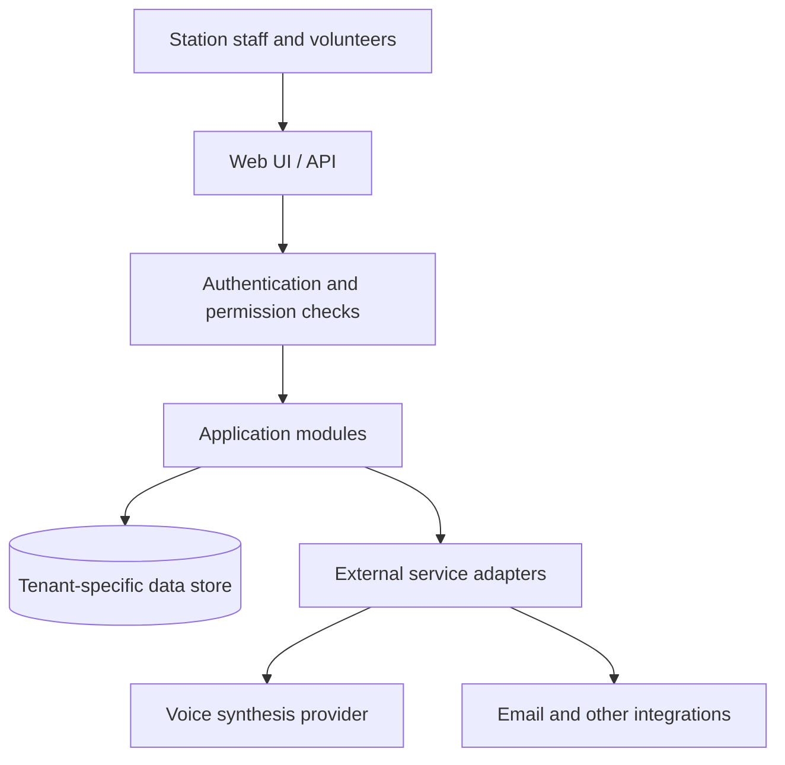

# Architecture overview

The production application uses plain PHP, MySQL, JavaScript and Bootstrap. Tenant resolution selects a station-specific database configuration; shared application modules implement contact management, communications and operations. The repository contains browser and mobile API surfaces, permission helpers and provider integrations.

## Selected implementation patterns
- Shared filter vocabulary prevents UI and query semantics from drifting; values are parameterised and predicates can be reused for data and count queries.
- Competition draws apply eligibility rules before server-side weighted randomisation; production confirmation re-checks eligibility separately.
- Voice synthesis uses a provider-dispatch boundary, station-specific configuration and an audio response contract. ElevenLabs is implemented; other providers are potential extensions only.
- Campaign pace logic is shared between reporting surfaces.

This deliberately omits production endpoints, tenant names, configuration and operational runbooks.
